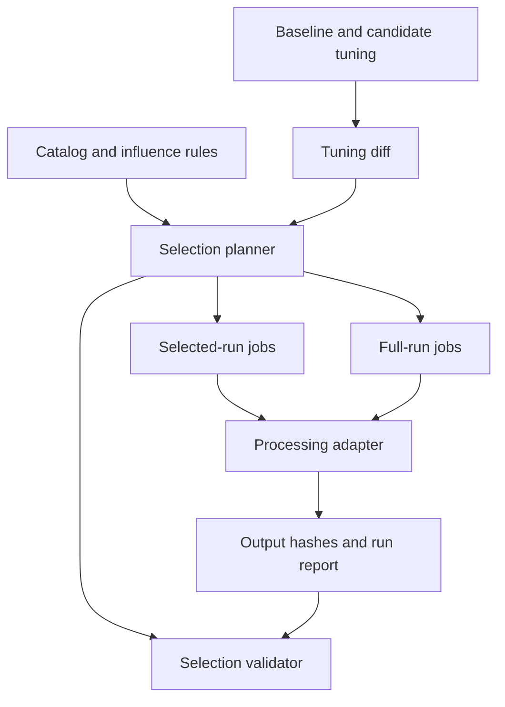

# ISP Impact — Design and Implementation

Version: 0.2.0  
Date: 11 October 2026  
Status: Working educational implementation; real ISP integration pending.

## 1. Purpose

ISP Impact answers this question:

> Given a tuning change, which existing inputs could produce different outputs and therefore need regression execution?

It reads a dataset catalog and tuning information, selects a conservative subset, invokes a processing adapter, and checks the selection against a full baseline/candidate run.

The controller does not infer the meaning of arbitrary tuning parameters. Engineers provide verified region-influence rules. It does not decide whether an output difference is an improvement or an unacceptable regression; that requires a separate image-quality or perception acceptance policy.

## 2. What is implemented

| Capability | Current implementation |
|---|---|
| Identify tuning changes | Compare two normalized JSON bundles; report changed module/region IDs |
| Select inputs | Compare frame trigger metadata with conservative region-influence ranges |
| Retain uncertainty | Include potentially affected inputs with missing metadata or unverified rules |
| Preserve temporal input groups | Expand selection to complete cataloged sequences |
| Run processing | Launch a trusted adapter for each still/sequence and tuning variant |
| Compare outputs | SHA-256 comparison of baseline/candidate artifact bytes |
| Validate selection | Detect changed frames excluded by the plan using a complete full run |
| Reproducibility checks | Bind tuning, catalog, rules and input hashes to an integrity-checked plan |
| Public demonstration | Generate and process actual grayscale image files |
| Distribution | Installable Python package, CLI, tests, GitLab CI configuration, MIT license |

Python 3.10+ is required. Runtime code uses the standard library. Packaging uses setuptools. Tests and the installed-wheel demo were executed on Python 3.12/Linux; macOS and Windows are intended targets but were not executed in this environment. Hosted GitLab CI has not yet been run.

## 3. Architecture



Selected and full are alternative runner modes. During development, the demo executes both. Validation requires the complete full-run report. It checks the selected flags in the plan against full-run changes; it does not compare selected-run artifacts against full-run artifacts.

### Code responsibilities

| File | Main responsibility | Familiar software-design analogy |
|---|---|---|
| `isp_impact/cli.py` | Commands, file loading and workflow coordination | Application service / composition root |
| `isp_impact/bundles.py` | Validate normalized tuning and compute differences | Change-analysis service |
| `isp_impact/selection.py` | Evaluate rules, add canaries, expand sequences, write manifests | Policy engine |
| `isp_impact/runner.py` | Build jobs, invoke adapters, hash outputs, validate reports | Process orchestrator |
| `isp_impact/demo.py` | Generate repeatable demonstration inputs | Test fixture builder |
| `isp_impact/demo_adapter.py` | Apply a simple denoising operation to actual pixels | Reference adapter |
| `tests/test_selection.py` | Selection boundary and fallback tests | Unit tests |
| `tests/test_workflow.py` | File/process execution and failure tests | Integration tests |

These are Python modules and functions, not a large class hierarchy. The process-level adapter boundary is the main extension point: a C#, Python or native executable can implement it without changing the selection engine.

## 4. Inputs and ownership

### 4.1 Dataset catalog

One CSV row represents one frame:

```csv
id,path,kind,sensor,pipeline,scenario,gain,cct,sequence_id,frame_index
frame-001,images/frame-001.raw,still,sensor-a,ipe,default,8,5000,,
```

- `id`: unique stable identity.
- `path`: local or mounted-file path; relative paths resolve against the catalog directory.
- `kind`: `still` or `sequence`.
- `sequence_id`, `frame_index`: mandatory for sequences; indices must be nonnegative integer strings and unique within a sequence.
- Trigger columns such as `gain` and `cct`: actual runtime trigger values with agreed units.
- Other columns pass through to adapter jobs.

The planner reads the file bytes to calculate input hashes, but does not decode the image. Thus real RAWs can be cataloged even though the bundled adapter only understands PGM.

The exporter must supply complete sequences from a known reset/start, including warm-up. The controller cannot establish original sequence completeness from the CSV alone. ISO must not be substituted for the interpolation gain signal without a verified mapping.

### 4.2 Baseline and candidate tuning

Baseline means the existing tuning; candidate means the proposed tuning. Both use this public normalized format:

```json
{
  "schema_version": 1,
  "execution_contract": {
    "pipeline": "demo-v1",
    "trigger": "gain",
    "interpolation": "linear-support-4-24"
  },
  "modules": {
    "DENOISE": {
      "regions": {
        "HIGH": {"parameters": {"strength": 0.2}}
      }
    }
  }
}
```

In the candidate, strength becomes `0.8`.

`execution_contract` records conditions that cannot safely be treated as local region-value changes: trigger layout, interpolation, routing, enables, control method, simulator version, and similar dependencies. Its actual keys are exporter-defined.

The current diff detects changes to complete region parameter objects; it does not report individual nested parameter paths. Changed module/region sets or changed execution contracts cause full-suite selection. Arbitrary semantic changes inside `parameters` cannot be recognized automatically: the exporter must classify nonlocal/control changes in the execution contract.

The CLI applies normalized bundles across the entire catalog. It does not resolve Chromatix inheritance or linked scenarios. Its diff marks scope resolved because it performs no scenario narrowing. A vendor exporter must not interpret this as automatic inheritance analysis.

### 4.3 Influence rules

```json
{
  "modules": {
    "DENOISE": {
      "locality_verified": true,
      "support_verified": true,
      "regions": {
        "HIGH": {"support": [{"gain": [4, 24]}]}
      }
    }
  }
}
```

The rule says that a HIGH-region value can contribute for gains from 4 through 24. This range must cover interpolation shoulders, not just the region's nominal label.

`locality_verified` asserts the changed values cannot affect executions outside that influence, including through feedback. `support_verified` asserts that the supplied ranges conservatively cover every contribution. These flags are engineering attestations, not results the controller computes. Unverified contracts widen selection.

Multiple axes in one box are ANDed; multiple boxes are ORed. Bounds are inclusive; `null` is unbounded. Broad boxes overselect, which is acceptable for a conservative initial implementation.

### 4.4 Adapter configuration

```json
{"argv":["{python}","/absolute/path/my_adapter.py","{job}"]}
```

The runner substitutes the Python executable and job-file path. Arguments are passed directly without a shell. Adapters are trusted local programs; this is not a sandbox for uploaded code.

## 5. Selection algorithm

The CLI validates and hashes all catalog inputs, computes the tuning diff, then invokes the planner.

1. **Check the change contract.** Incomplete/unknown contracts or structural changes widen selection to the full catalog. Unknown modules also trigger full fallback.
2. **Evaluate scope where supplied.** The underlying engine can match sensor/pipeline/scenario lists. The current normalized CLI emits no scope restriction.
3. **Match changed regions.** Include rows inside any changed region's support. Union results across all changes.
4. **Retain uncertainty.** Missing/invalid trigger values keep potentially affected rows. If another known axis proves a row outside every applicable box, it can still be excluded.
5. **Add canaries.** Sample 5% of currently excluded rows per sensor/pipeline/scenario/kind group, rounded up. Selection is deterministic using hashes of frame IDs.
6. **Expand sequences.** If any frame is selected, retain every cataloged frame in that sequence. This also applies to canaries.
7. **Write the plan.** Record flags, reasons, summaries and fingerprints.

The low-level engine retains optional complete active-region trace support from the earlier POC. The v0.2 CLI does not emit a trusted trace context, so normal CLI plans use influence rules. Trace extraction and provenance are not implemented integrations.

### Selection example

For a changed HIGH region whose influence is `[4,24]`:

| Frame metadata | Initial decision | Reason |
|---|---|---|
| Gain 2 | Exclude | Outside influence |
| Gain 6 | Include | Interpolation contribution is possible |
| Gain 12 | Include | Inside influence |
| Gain 24 | Include | Inclusive boundary retained conservatively |
| Gain 32 | Exclude | Outside influence |
| Gain missing | Include | Cannot prove outside influence |

An initially excluded row may later be included as a canary or sequence companion. Inclusion means “needs checking,” not “will definitely change.”

## 6. Temporal behavior

Suppose frame 5 falls in a changed trigger region and the sequence contains frames 0–9. Running only frame 5 can omit prior state and later effects. The planner therefore selects all ten cataloged frames.

The runner groups the sequence into one job per tuning variant, orders frames by index, and requests a reset at the sequence boundary. The adapter must implement the reset and preserve state between frames. The runner cannot inspect hidden simulator state.

This conservative approach avoids estimating a temporal history window. It may retain many unaffected frames. The bundled filter is stateless: tests verify sequence selection/grouping, not the correctness of a real temporal ISP.

## 7. Runner and adapter protocol

For every selected still or sequence, the runner creates a baseline job and a candidate job. Full mode does the same for every catalog entry/group.

A job contains:

| Field | Meaning |
|---|---|
| `schema_version` | Job format version |
| `variant` | Baseline or candidate |
| `tuning` | Complete normalized tuning bundle |
| `reset_state` | Reset requested before processing the job |
| `kind` | Still or sequence |
| `frames` | Ordered frame rows, paths and metadata |
| `output_dir` | Unique directory for this job |
| `result_path` | Location where the adapter must write its result |

The adapter returns exactly one distinct artifact per frame:

```json
{"artifacts":{"frame-001":"frame_000000.yuv"}}
```

Artifacts must resolve inside that job's output directory. Missing outputs, malformed results, timeouts and nonzero exits fail execution. Logs are recorded per job. Failed runs cannot pass the full-run validator.

A thread pool schedules external processes; the default is two workers. Independent jobs may overlap, but the adapter processes sequence frames in order. Timeout applies to the directly launched process; adapters remain responsible for cleaning up child processes they launch.

The runner checks tuning hashes and input hashes before execution and input hashes again afterward. Existing output directories are rejected to avoid stale output reuse. Planning itself reads all input bytes, so selection is not a metadata-only I/O operation in v0.2.

## 8. Validation: checking whether pruning missed anything

For each frame in a complete full run:

```text
changed = SHA256(baseline artifact) != SHA256(candidate artifact)
missed = changed AND frame was excluded by the plan
```

Validation requires a successful full report with the same plan ID, input fingerprints and exactly one observation per frame. A selected-only report cannot establish whether excluded frames changed and is rejected.

Observed recall is:

```text
selected changed frames / all changed frames
```

If there are no changed frames, recall is `null`: there is no positive evidence that the selector catches effects. A run passes this gate when no changed frame was excluded.

This is empirical coverage for one change/run. It does not prove future safety or assess visual quality. Exact hashing also flags harmless formatting/timestamp differences; adapters should emit deterministic artifacts. Non-deterministic pipelines need a repeatability policy before output differences can be interpreted usefully.

Plan hashes detect accidental changes, not malicious tampering. The adapter configuration is hashed in the report, but executable bytes are not automatically fingerprinted or checked against the plan. Record executable/build identity in the execution contract when integrating.

## 9. What the demonstration actually computes

The demo generates 48 deterministic 32x32 grayscale images with a noisy dark/light edge, using a fixed random seed. It stores real pixel data in plain PGM files.

For every pixel, the adapter computes a 3x3 neighbourhood average, clipped to the image boundary. It blends the original pixel with that average:

```text
region_weight = max(0, min(1, (gain - 4)/4, (24 - gain)/8))
effective_strength = tuned_strength * region_weight
output = round(original * (1 - effective_strength)
               + neighbourhood_average * effective_strength)
```

The baseline strength is 0.2; candidate strength is 0.8. Outside the influence range, the weight is zero and the changed strength has no effect.

One frame intentionally has missing selection gain. A separate demo-only `processing_gain` lets the adapter process it while testing the selector's missing-metadata behavior. This is a controlled fixture, not a proposed metadata strategy for real datasets.

### Observed demonstration results

| Measurement | Result |
|---|---:|
| Total frames | 48 |
| Direct selections before canaries/sequence expansion | 29 |
| Final selected frames | 35 |
| Excluded frames | 13 |
| Frame reduction | 27.08% |
| Changed output frames in full run | 20 |
| Changed frames missed | 0 |
| Full process jobs | 78 |
| Selected process jobs | 52 |

There are 36 independent stills and three four-frame sequences. Thus the full run has `(36 + 3) * 2 = 78` jobs. The selected set has 23 stills and all three sequences, giving `(23 + 3) * 2 = 52` jobs. Frames and jobs are different counts.

These results replace the earlier metadata-only POC's 300-frame example for this release. They do not establish real ISP time savings; process startup dominates the tiny demo.

## 10. Outputs and commands

| Output | Contents |
|---|---|
| `plan.json` | Complete decisions, reasons, input/tuning/rule fingerprints and plan ID |
| `selected.csv` | Rows to execute |
| `decisions.csv` | Included and excluded rows |
| `job.json` | One execution request |
| `stdout.log`, `stderr.log` | Adapter diagnostics |
| `result.json` | Adapter artifact mapping |
| `run.json` | Execution status, hashes, errors and observations |
| `summary.json` | Demo summary |

From the repository directory:

```bash
python3 -m isp_impact demo --out design-demo
python3 -m unittest discover -s tests -v
```

After installation, individual commands are `isp-impact diff`, `plan`, `run`, and `validate`. Full argument examples are in README.md. Every demo/run should use a new output directory.

Exit codes: `0` success; `1` input/configuration error; `2` processing failure or validation miss. A no-op tuning diff is reported as a planning error rather than a meaningful regression result.

## 11. Tests and evidence

The current test suite has 28 passing tests: 15 selector tests and 13 workflow tests.

Covered cases include interpolation boundaries, multiple axes, missing/nonfinite metadata, scope handling, sequence expansion, deterministic canaries, unknown modules/rules, stale trace fallback, full-versus-selected validation, modified inputs/tuning/plans, adapter failures, missing artifacts, timeouts and output-directory reuse.

A particularly important test deliberately supplies an incorrect narrow support range `[10,14]`, runs the full real-pixel pipeline, and verifies the validator detects missed changed outputs. This demonstrates the validation mechanism can fail when the supplied influence model is wrong.

The package wheel was also built, installed in a separate virtual environment, and the complete demo executed from outside the source folder. These tests validate the implementation and example, not a proprietary ISP model or production accuracy.

## 12. Design choices and trade-offs

| Decision | Reason | Cost or limitation |
|---|---|---|
| Rule-based selection | Explainable decisions grounded in trigger contribution | Requires trustworthy engineering rules |
| Normalized JSON | Public, vendor-neutral interface | Needs a vendor-specific exporter |
| Complete sequence replay | Preserves possible temporal dependencies | Can substantially reduce pruning benefits |
| Conservative fallbacks | Avoid exclusions when contracts are unknown | May select the whole dataset |
| Exact output hashes | Simple reproducible difference detection | Does not measure image quality |
| External-process adapters | Works across languages and simulator implementations | Process overhead; adapter owns state correctness |
| Input hashing | Detects changed files between planning and execution | Reads all input data; expensive at scale |
| CSV and in-memory decisions | Easy to inspect and learn | Not a PB-scale catalog implementation |

## 13. Connecting to a real camera workflow

The recommended first integration is one sensor, one pipeline/scenario, one spatial tuning parameter, and a small existing dataset.

1. Export the existing regression metadata into the catalog. Use effective trigger values and complete sequences where relevant.
2. Export baseline/candidate tuning into normalized bundles. Resolve inheritance/links correctly and put nonlocal differences in the execution contract.
3. Establish the changed region's conservative support from the actual interpolation implementation. Leave verification flags false until checked.
4. Implement an adapter that loads the correct tuning, resets state, invokes the complete simulator pipeline, and returns deterministic output artifacts.
5. Run full baseline/candidate regression in shadow mode and investigate every excluded changed frame.
6. Add real IQ/perception acceptance metrics and periodic full regression before relying on pruning.

A change in ANR can affect downstream sharpening, color processing or perception. Selecting an input does not mean running only ANR: the adapter should run the complete intended evaluation pipeline.

## 14. Remaining work

Not implemented: proprietary tuning parsing, automatic interpolation-support derivation, inheritance resolution, trusted simulator trace export, RAW decoding in the demo adapter, IQ/perception metrics, hardware control, GUI, distributed scheduling, object-storage access, indexed catalogs, resume/caching, or automatic CI policy updates after a miss.

The next practice milestone should be a real adapter and a small authorized dataset. That tests the most important open assumption: whether the actual trigger metadata and interpolation rules predict output influence accurately. Scaling or adding a UI is useful after that mapping works.
